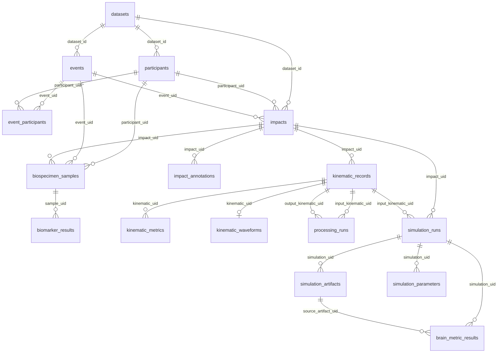

# Head Impact Data Platform

**Last updated: 10 November 2026**

Research data platform developed within the [HEAD Lab](https://headlab.org/) at Imperial College London for organising and linking multimodal head-impact data.

The platform uses:

- **DuckDB** for structured metadata, IDs, relationships and provenance
- **NAS storage** for large research files and simulation artefacts
- **Streamlit** as a read-only interface for browsing, checking data availability and exporting clean linked data

The main aims are to:

- maintain consistent and unique IDs across datasets;
- link kinematics, simulations, brain metrics and other associated data;
- identify missing or incomplete data;
- provide a single canonical source for clean research exports.

## Repository structure

```text
app/      Streamlit interface and application code
schema/   DuckDB schema
sql/      ingestion and QC scripts
```

Research data and DuckDB database files are not stored in this repository.

For local setup and running the Streamlit app, see [CONTRIBUTING.md](CONTRIBUTING.md).

## Architecture

The platform separates software, structured metadata and large research files.
                     Head Impact Data Platform

                              Streamlit
                           read-only interface
                                  │
                                  ▼
                               DuckDB
                    metadata · IDs · relationships
                     provenance · availability · QC
                                  │
                    ┌─────────────┴─────────────┐
                    ▼                           ▼
          Embedded structured data       External research storage
           e.g. selected waveforms       e.g. kinematics, FE runs,
                                         NIfTI spatial fields
External files are referenced using logical storage locations rather than machine-specific absolute paths.

For example:
storage_root = NAS_HEAD_IMPACT
relative_path = DS003_RFU546/...
This allows the same database to be used across local development machines, servers and future institutional infrastructure without rewriting stored file paths.

## Database schema

The diagram below is generated automatically from [`schema/schema.sql`](schema/schema.sql). 
Full table definitions are available in [`schema/schema.sql`](schema/schema.sql).

<!-- SCHEMA_MERMAID_START -->

<!-- SCHEMA_MERMAID_END -->


## Local development

See CONTRIBUTING.md for the current local development workflow, Python environment setup and instructions for running the Streamlit interface.
